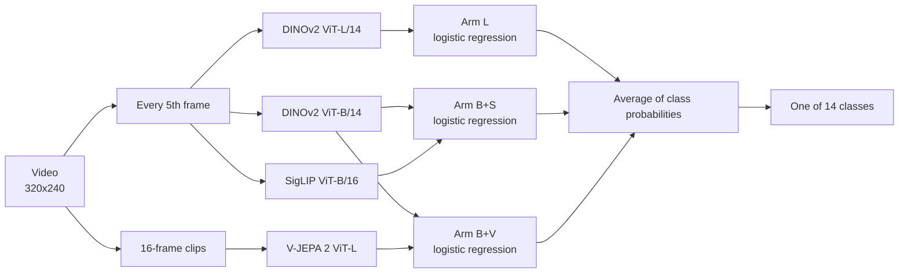

# SHAR: Suspicious Human Activity Recognition

[](LICENSE)


**Naming the crime in surveillance video, without fine-tuning and without extra labels.**

SHAR classifies a surveillance video into one of the 13 crime and accident classes of
[UCF-Crime](https://www.crcv.ucf.edu/research/real-world-anomaly-detection-in-surveillance-videos/), or Normal. Its final model, **E3**, averages three
logistic-regression classifiers built on four frozen foundation models. On the dataset's official four-fold split it
reaches **46.2% accuracy and 0.455 macro-F1**, with the correct class in its top three **72.2%** of the time.

A semester-7 student research project. This repository holds the code, configurations, tests, decision records and
aggregate results. It contains **no dataset media, no model weights and no feature caches** (see
[Getting started](#getting-started)).

---

## Why this problem

Most video-surveillance research asks *whether* something unusual is happening. An operator also needs to know
*what* is happening: a road accident needs a different response from a robbery. Naming the event is harder.
The footage is 320×240, the people involved are often a few dozen pixels tall, and the crime may fill a few seconds of
a ten-minute video. On UCF-Crime's official recognition split, the dataset's authors reported 23.0% and 28.4%.

## Results

All numbers are means over the 4 official folds and 3 seeds unless stated. Labels are video-level: every frame
inherits its video's label, so scores measure whether a video gets its label, not whether the event itself was seen.

| Method (official 4-fold split) | Extra annotation | Accuracy |
|---|---|---|
| Chance (14 classes) | none | 7.1% |
| C3D, dataset authors | none | 23.0% |
| 3D ResNet-34 | none | 27.2% |
| TCNN, dataset authors | none | 28.4% |
| Maqsood et al. (single split) | hand-added frame labels | 45% |
| **E3 (this repository)** | **none** | **46.2%** |

The 45% figure uses a single split and hand-made frame labels, so we read it as the same range, not as a controlled
comparison. Many papers report 80–90% on "UCF-Crime" by splitting frames at random, which puts frames of one video on
both sides of the split; every figure here uses the official video-level split.

**Other findings**

| Study | Result | Note |
|---|---|---|
| Evaluation protocol | Inner cross-validation predicted 0.445 macro-F1; the test gave 0.455 | Small validation sets (56 videos) hid three real +0.03 gains |
| 7 crime families | 58.2% accuracy | Reporting view of the same model |
| Label ceiling | A text classifier on human captions reaches 0.80 macro-F1 | The bottleneck is the visual features, not the labels |
| Restoration vs recognition | PSNR vs macro-F1 change: rank correlation 0.18 over 100 conditions | Adaptive median recovers 91–93% under salt-and-pepper noise |
| Online anomaly detector (separate task) | 0.816 frame AUC; 72% event recall at about 17 false alarms/hour | Four published training tweaks changed AUC by at most 0.0011 |
| RWF-2000 transfer (2-class task) | 80.8% accuracy with the unchanged recipe | Not comparable with the 14-class result |

Approaches that did not help are recorded too: partial fine-tuning, person crops, optical flow, extra datasets,
special losses and more ([`docs/REMEDIES_TRIED.md`](docs/REMEDIES_TRIED.md)).

## How E3 works



1. **Frozen features.** Four public foundation models turn each frame (or clip) into a vector. None of their weights
   are changed.
2. **One vector per video.** Each model's vectors are averaged over the whole video.
3. **Three linear arms, averaged.** Logistic regression on DINOv2-L; on DINOv2-B + SigLIP; on DINOv2-B + V-JEPA 2.
   The equal-weight average of their probabilities is the prediction. The three models learned differently (images;
   images with text; video), so their mistakes differ.

With features cached, training all arms for 4 folds × 3 seeds takes under three minutes on 8 CPU cores. Inference
on one 18 GB GPU slice analyses about 36 frames per second.

## Live demo

`ui/demo/` is a small web app: upload a video, or drag in a built-in example, and E3 returns its prediction, top-5
classes and a per-window timeline. A prototype overlay uses the anomaly detector to flag *when* something unusual
starts, and draws a box around the area of strongest motion at that moment. The box marks activity; it does not
locate the crime. The server is standard-library Python; the page is plain HTML and JavaScript.

## Repository layout

| Path | Contents |
|---|---|
| `core/`, `data/`, `models/`, `eval/` | Library code: data loading, frozen backbones, classifiers, detector, metrics |
| `scripts/` | Command-line entry points (thin wrappers around `core/`) |
| `configs/` | Registered experiment configurations, including model-weight digests |
| `tests/` | Unit tests; tests that need local data skip themselves |
| `docs/` | Decisions log, evidence register, training log, known problems, reviews |
| `results/` | Aggregate results, manifests and verification records (no media) |
| `ui/` | Demo web page and server |
| `requirements/` | Pinned environments |

Key scripts: `scripts/run_inner_cv.py` and `scripts/run_inner_cv_candidates.py` (model selection by inner
cross-validation), `scripts/fuse_inner_cv.py` (the E3 average), `scripts/run_final_test.py` (the declared test read),
`scripts/run_detector.py` (anomaly detector), `scripts/run_p2_classical.py` and `scripts/run_p2b_learned.py`
(restoration study), `scripts/run_rwf2000.py` (transfer).

## Getting started

```bash
git clone https://github.com/Vishnuuuu24/SHAR-CAPSTONE.git
cd SHAR-CAPSTONE
python3.12 -m venv .venv && source .venv/bin/activate
pip install -r requirements/p0c-lock.txt   # or p0c-lock-dgx-cu126.txt for CUDA 12.6
python -m unittest discover -s tests -p "test_*.py"
```

To reproduce results you also need:

- **UCF-Crime videos and annotations** from the [official source](https://www.crcv.ucf.edu/research/real-world-anomaly-detection-in-surveillance-videos/),
  under its terms. They are not redistributed here.
- **Model weights** for DINOv2, SigLIP and V-JEPA 2 from their publishers, placed under `.cache/weights/`. Their
  expected SHA-256 digests are in `configs/`.
- **A CUDA GPU** for feature extraction. The classifiers themselves train on a CPU.

The trained E3 classifier files and per-video feature caches are not part of this release. Configuration and log
files were written on the project's GPU cluster; placeholders such as `<repo>`, `<user>` and `<head-node>` replace
machine-specific values.

## Reproducibility

- Every decision, with its date and reason, is in [`docs/DECISIONS.md`](docs/DECISIONS.md); measured figures are in
  [`docs/TRAINING_LOG.md`](docs/TRAINING_LOG.md) and [`docs/EVIDENCE_REGISTER.md`](docs/EVIDENCE_REGISTER.md).
- Model choices were made by inner cross-validation on training videos with rules fixed before the runs.
- The test folds were read three times, each declared: an earlier pipeline (0.414 macro-F1 / 41.8%), one diagnostic
  baseline that selected nothing, and the final pipeline (0.455 / 46.2%).
- Runs record their seed, configuration, code revision and data digest.

## Limitations and responsible use

This is a research baseline and is **not fit for operational use**.

- It assigns the wrong class to more than half of the test videos. Action-defined classes are hardest: F1 is 0.158
  for Shooting, 0.276 for Assault and 0.305 for Fighting.
- It leans on scene context as well as the action, and it is weaker on UCF-Crime videos outside the official split.
- The detector raises about 17 false alarms per hour of normal footage.
- Errors across demographic groups, places and camera types have not been assessed.

Its outputs must not be used to accuse, identify or act against any person.

## How this project was built

The team used AI coding assistants for much of the implementation, analysis and documentation. Design decisions,
approvals and every reported number are recorded in `docs/`; the working rules are in
[`docs/PROJECT_RULES.md`](docs/PROJECT_RULES.md).

## Team

Priyodip, Likith, Vishnu and Abijith.

## Acknowledgements

UCF-Crime (Sultani, Chen and Shah, CVPR 2018); DINOv2 and V-JEPA 2 (Meta AI); SigLIP (Google); Restormer and NAFNet,
whose architecture code is included under the MIT License.

## Licence

MIT. See [`LICENSE`](LICENSE). Third-party code keeps its own notice. Datasets and model weights are governed by their
own terms.
